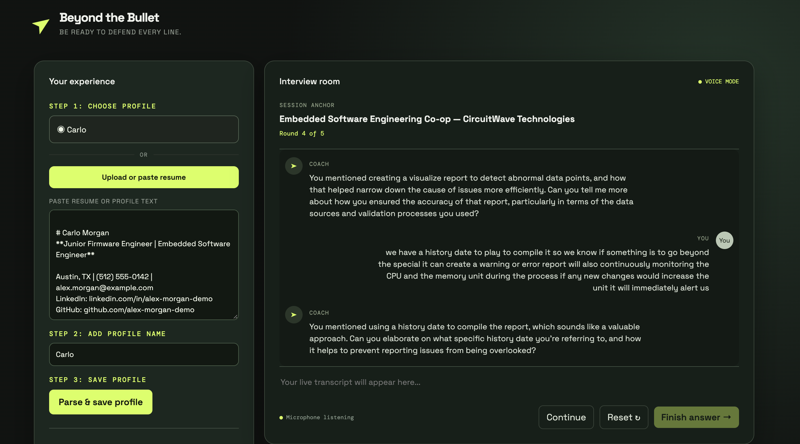
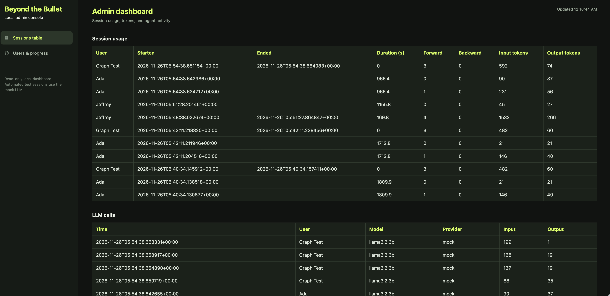
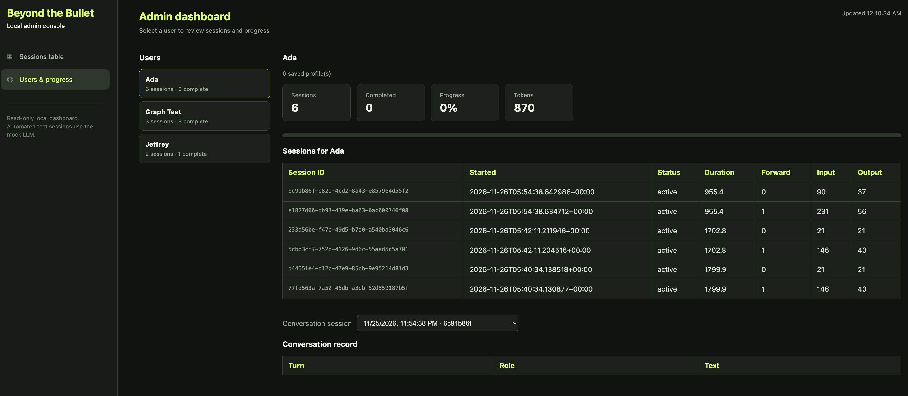

# Beyond the Bullet

Local, resume-grounded interview practice for defending every line of your experience.

## Table of contents

- [Features](#features)
- [Screenshots](#screenshots)
- [Run locally](#run-locally)
- [Tests](#tests)
- [Scope and privacy](#scope-and-privacy)
- [Optional local voice models](#optional-local-voice-models)
- [Optional browser voice mode](#optional-browser-voice-mode)

## Features

Beyond the Bullet is a local-first AI interview coach. It turns a resume into a set of grouped work, education, and project histories, then helps the candidate explain ownership, implementation decisions, tradeoffs, and measurable outcomes.

The repository currently implements the local MVP:

- local-only, no-login profile creation with resume text or TXT/PDF/DOCX upload
- grouped parsed work, education, and project history with source-backed bullet lists
- adaptive follow-up questions through Ollama when available, with an offline fallback
- LangGraph orchestration for opening questions, follow-ups, transcript state, and model-driven completion
- automatic progression from one planned job, education entry, or project to the next, with a continuous transcript in the browser
- persisted sessions, pause/resume, transcript-grounded feedback, approved Experience Vault facts, and a bullet dashboard API
- optional browser voice mode with automatic pause detection, recognition recovery, and browser-console diagnostics
- optional local `faster-whisper` speech-to-text and Kokoro text-to-speech adapters
- read-only admin dashboard for sessions, token usage, user progress, conversation records, and AI interviewer activity
- deterministic mock provider and repeatable Carlo, Daniel, and Melissa resume workflows for UI testing without paid model calls

## Screenshots

### Interview workspace

The main workspace combines resume parsing, grouped history, and a continuous interview transcript.



### Admin session usage

The local admin dashboard exposes session duration, forward/backward navigation, and token usage.



### Admin users and progress

Administrators can select a user and review multiple sessions, progress, and a selected conversation.



## Run locally

```bash
python3.12 -m venv .venv
source .venv/bin/activate
python -m pip install -r requirements.txt
npm --prefix frontend install
npm --prefix frontend run build
uvicorn backend.main:app --reload
```

Use Python 3.11 or 3.12. The optional voice dependencies currently do not support Python 3.14.

Open <http://127.0.0.1:8000>. The app stores local data in `data/store.json`, which is ignored by Git.

To delete every local profile and its related sessions, facts, transcripts, and metrics from the canonical repository-local store:

```bash
./.venv/bin/python -m backend.cli delete-all-profiles
# or skip the confirmation prompt explicitly:
./.venv/bin/python -m backend.cli delete-all-profiles --yes
```

For local LLM questions, follow [docs/Llama-LLM-Local-Setup.md](docs/Llama-LLM-Local-Setup.md), install and run [Ollama](https://ollama.com), then pull a model:

```bash
ollama pull llama3.2:3b
```

Set `OLLAMA_URL` and `OLLAMA_MODEL` to use another local Ollama model. If Ollama is unavailable, the app uses clearly bounded deterministic prompts so the interface remains testable offline.

## Tests

```bash
./.venv/bin/python -m pytest -q
npm --prefix frontend run build
```

Playwright tests run with `npm --prefix frontend test`; the Playwright configuration starts isolated application and admin servers automatically.

To watch the complete Playwright suite in a browser, use `npm --prefix frontend run test:headed`. For a slower run that makes each browser action easier to follow, use `npm --prefix frontend run test:headed:slow` (500 ms between actions). You can choose another delay with `PW_SLOW_MO`, for example `PW_SLOW_MO=1000 npm --prefix frontend run test:headed`.

To record the slow headed run for later playback, use `npm --prefix frontend run test:headed:slow:video`. Playwright saves the recordings as `.webm` files under `frontend/test-results/`, one video per test. Open a `.webm` file in a browser or media player. To record a different run, set `PW_VIDEO=on`, for example `PW_VIDEO=on npm --prefix frontend run test:headed -- admin-dashboard.spec.ts`.

The Carlo resume upload E2E test runs with `npm --prefix frontend test`. Run the separate local admin dashboard with `uvicorn backend.admin:app --reload --port 8001`, then open <http://127.0.0.1:8001>. The admin Sessions table shows usage and agent activity; select Users & progress to choose an individual session by ID/start time and inspect only that session's transcript. Normal usage is stored in `data/store.json` and `data/metrics.sqlite3`. Playwright uses isolated `.data/e2e` storage and cleans it up after the suite.

## Scope and privacy

The app is intentionally a localhost prototype: there is no login, hosted inference, analytics export, URL scraping, or public deployment. Resume/profile text is treated as untrusted candidate data; it is not used as system instructions. Delete a local profile from the profile menu when its data should be removed.

The default interview mode is text-only. Speech-to-text and text-to-speech are not enabled unless voice mode is explicitly enabled. The Playwright suite covers the Carlo TXT resume plus the Daniel PDF and Melissa DOCX resumes, using a deterministic mock LLM and three candidate answers per interview. Test data is isolated from normal local profiles.

## Optional local voice models

The backend includes opt-in adapters for local `faster-whisper` speech-to-text and Kokoro text-to-speech. Install them only when working on local model voice mode:

```bash
source .venv/bin/activate
pip install -r requirements-voice.txt
export LOCAL_VOICE_MODE=true
export WHISPER_MODEL=small.en
uvicorn backend.main:app --reload --port 8000
```

The first speech request may download the selected model weights. Models are not initialized or downloaded at server startup. Check `/api/voice/status`; use `POST /api/voice/transcribe` with an audio upload and `POST /api/voice/synthesize` with `{"text":"..."}`. See [docs/Local-Voice-Setup.md](docs/Local-Voice-Setup.md) for configuration and hardware notes.

## Optional browser voice mode

Voice is opt-in. The default build remains text-only. To enable browser speech-to-text and text-to-speech controls:

```bash
VITE_ENABLE_VOICE=true npm --prefix frontend run build
uvicorn backend.main:app --reload --port 8000
```

For development with Vite:

```bash
VITE_ENABLE_VOICE=true npm --prefix frontend run dev -- --host 127.0.0.1 --port 5173
```

Voice mode uses the browser's `SpeechRecognition`/`webkitSpeechRecognition` and `speechSynthesis` APIs. The coach transcript types progressively while speech plays; after the coach finishes, the microphone starts automatically and interim candidate speech appears live in the transcript field. A brief pause submits the answer automatically; unexpected recognition endings are recovered when possible. Voice diagnostics are written to the browser developer console with the `[Beyond the Bullet voice]` prefix. There are no Talk or Listen toggle buttons in voice mode. Browser support and microphone permissions are required. Automated tests intentionally leave this flag disabled.

For a built app, voice mode can also be enabled per URL without rebuilding by opening <http://127.0.0.1:8000/?voice=1>. The browser will request microphone permission when the first coach question finishes speaking.

Automated tests never spend model tokens: `tests/conftest.py` forces `MOCK_LLM=1` for unit tests, and the Playwright web servers use the same flag. The mock provider exercises API responses, session state transitions, transcript rendering, profile switching, parsing, metrics, and admin-agent reporting without calling Ollama or a paid model. Use the real Ollama model only for manual development runs.
